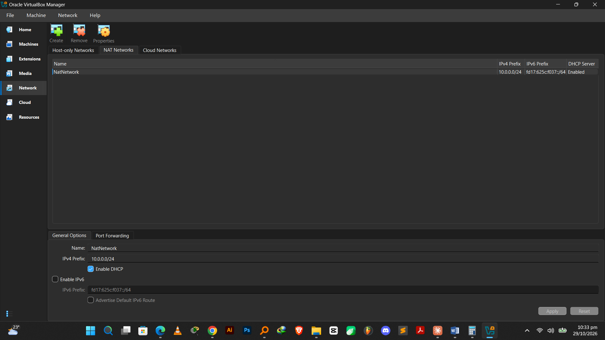
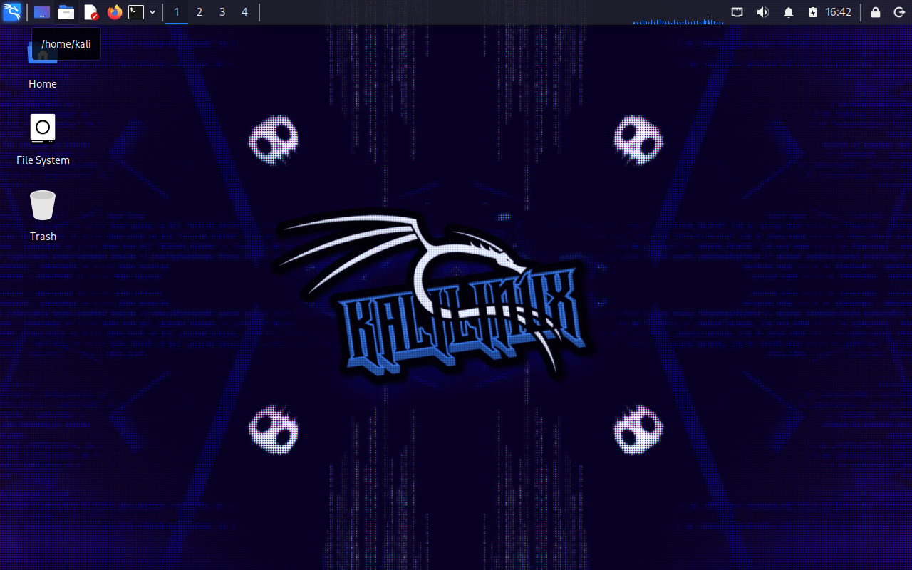
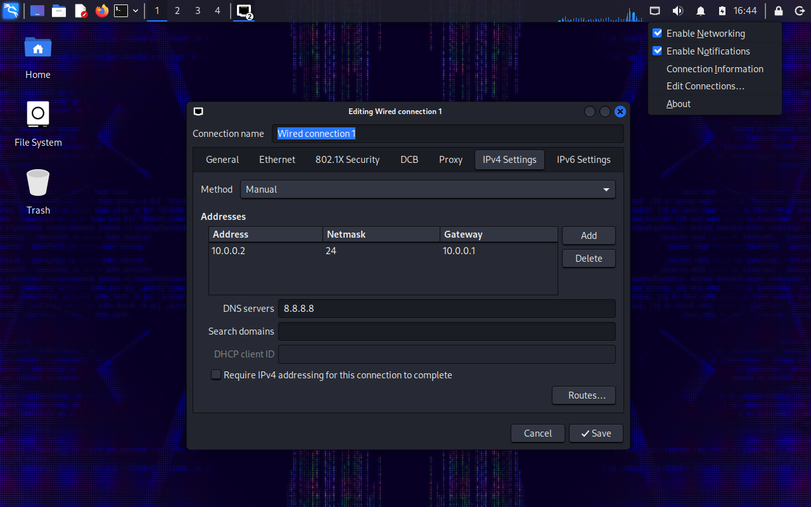

# 🔐 Cybersecurity Lab Environment Setup


> **Building an isolated virtual lab for penetration testing and ethical hacking practice.**

---

## 📌 Project Overview

This project sets up a **virtual cybersecurity and penetration-testing laboratory** using VirtualBox and Kali Linux.

The lab provides a controlled environment where security tools, network scanning, reconnaissance, vulnerability assessment, and other testing activities can be performed safely and repeatedly.

It runs on a **private virtual network**, so additional machines can be added later and used as targets for authorised security testing.

---

## 🎯 Objectives

- Install and configure VirtualBox
- Install and import Kali Linux as a virtual machine
- Create a private **NAT Network** for the lab
- Configure network connectivity for Kali Linux
- Assign a consistent IP address to the Kali VM
- Verify network connectivity and DNS resolution
- Take a clean VM snapshot for recovery
- Document the complete setup process
- Prepare the environment for future cybersecurity projects

---

## 🛡️ Purpose of the Lab

The lab is an isolated environment for cybersecurity learning and authorised security testing.

It can be used for:

- Network reconnaissance
- Port scanning
- Vulnerability assessment
- Packet analysis
- Web security testing
- Exploitation practice
- Security-tool experimentation

> ⚠️ **Important:** This lab must only be used on systems you own or have explicit permission to test. Do not use the lab or its tools to attack unauthorised systems.

---

## ⚙️ Lab Configuration

| 🧩 Component | ⚙️ Configuration |
|---|---|
| 🖥️ Host OS | Windows 11 |
| 🧠 Host RAM | 8 GB |
| ⚡ Processor | Intel Core i5 |
| 🧰 Hypervisor | VirtualBox 7.2 |
| 🐉 Security OS | Kali Linux 2026.2 |
| 🧠 Kali RAM | 2048 MB |
| 🌐 Virtual Network | NAT Network |
| 📡 Network Address | 10.0.0.0/24 |
| 🐧 Kali IP Address | 10.0.0.2/24 |
| 🚪 Default Gateway | 10.0.0.1 |
| 🌍 DNS Server | 8.8.8.8 |
| 🔮 Future VM Range | 10.0.0.3 – 10.0.0.99 |

---

## 🪜 Lab Setup Procedure

### Step 1: Install 7-Zip

7-Zip was installed to extract the Kali Linux virtual machine package, which may be distributed as a `.7z` archive.

- **Tool:** [7-Zip](https://7-zip.org/download.html)

### Step 2: Install VirtualBox

VirtualBox 7.2 was installed as the hypervisor.

### Step 3: Create the NAT Network

A dedicated NAT Network was created in VirtualBox.

```
Network Name:  NatNetwork
IPv4 Prefix:   10.0.0.0/24
DHCP:          Enabled
IPv6:          Disabled
```



A **NAT Network** was chosen because multiple virtual machines connected to the same NAT Network can communicate with one another while still having outbound internet connectivity. This allows future attacker and target VMs to interact within the lab.

### Step 4: Import Kali Linux

The Kali Linux virtual machine was downloaded from the official Kali Linux website and imported into VirtualBox.

The network adapter was configured as follows:

```
Adapter 1
  Attached to:  NAT Network
  Network:      NatNetwork
  Adapter Type: Intel PRO/1000 MT Desktop
```

The VM was allocated:

```
RAM: 2048 MB
```

A shared folder was also configured to transfer files between the Windows host and the Kali VM.



### Step 5: Configure the Kali Linux Network

The network configuration was checked and set to a consistent IPv4 address:

```
IP Address:   10.0.0.2
Subnet Mask:  255.255.255.0
Gateway:      10.0.0.1
DNS:          8.8.8.8
```

A fixed IP address makes the lab easier to document and makes the Kali machine simple to reference in future exercises.



### Step 6: Create a Clean VM Snapshot

After the initial configuration was complete, a VirtualBox snapshot was taken:

```
Snapshot name: MY FRESH KALI
```

This snapshot is the clean baseline of the lab. If a future exercise changes or damages the VM configuration, the machine can be restored to this state.

---

## 🔎 Lab Verification

| ✅ Test | 🧾 Command | 🎯 Expected Result |
|---|---|---|
| 🌐 Check IP address | `ip a` | Correct Kali IP displayed |
| 📡 Test gateway | `ping 10.0.0.1` | Successful replies |
| 🌍 Test internet connectivity | `ping 8.8.8.8` | Successful replies |
| 🔎 Test DNS resolution | `nslookup networkwalks.com` | Domain resolves |
| 🧰 Verify Nmap | `nmap --version` | Nmap version displayed |
| 🔄 Verify snapshot | Restore snapshot, then run `ip a` | Baseline configuration restored |

### Example Results

```
IP Address:  10.0.0.2/24
Gateway:     10.0.0.1
DNS:         8.8.8.8
```

---

## 🐞 Problems Encountered & Solutions

Documenting problems is an important part of this project.

### Problem 1: Internet connectivity after static IP configuration

After manually configuring the IPv4 settings, internet connectivity may fail depending on the Kali/NetworkManager configuration.

The workaround used in this lab:

```bash
sudo nmcli connection modify "Wired connection 1" ipv4.dad-timeout 0
```

The network connection was then restarted (or the VM rebooted), and connectivity was tested again.

> **Note:** Connection names may differ between systems. Run `nmcli connection show` first to identify yours before running the command.

---

## 💡 What I Learned

### 1. NAT vs NAT Network
A standard NAT isolates each VM behind the host. A NAT Network lets multiple VMs on the same virtual network communicate with one another while still providing address translation for outbound traffic. This makes it useful for building a multi-machine lab.

### 2. Virtual Machine Networking
VirtualBox virtual adapters connect VMs to different types of networks, and the network configuration determines how machines can communicate.

### 3. Static IP Configuration
Configuring and verifying IPv4 addressing, subnet masks, gateways, and DNS settings in Kali Linux.

### 4. VM Snapshots
A clean snapshot should be taken **before** performing risky or experimental activities. It provides a known-good recovery point.

### 5. Documentation
Recording commands, configuration, screenshots, problems, and solutions is an important part of a professional cybersecurity project.

---

## 🔐 Security & Ethical Use

This laboratory is intended strictly for educational purposes. Only test systems you own or have explicit written permission to assess.

---

## 🔗 Tools & Resources

- **7-Zip:** [7-zip.org/download.html](https://7-zip.org/download.html)
- **VirtualBox:** [virtualbox.org/wiki/Downloads](https://www.virtualbox.org/wiki/Downloads)
- **Kali Linux:** [kali.org/get-kali](https://www.kali.org/get-kali/)

---

## 👤 Author

**Simumba AKAKULUBELWA**
Cybersecurity Professional · B084
🔗 [LinkedIn](https://www.linkedin.com/in/simumba-akakulubelwa/)

---

## 📌 Project Information

**Program:** Cybersecurity at Networkwalks · **Week:** 01 · **Project:** Cybersecurity & Pentesting Lab Setup · **Repository:** GitHub
